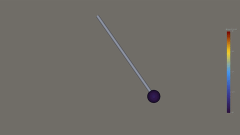

# World Embedding Benchmark: Physics Simulation

Physics simulation tools for the [World Embedding Benchmark](https://github.com/World-Representation-Lab/World-Embedding-Benchmark),
spanning Fluid Mechanics, Solid Mechanics, Dynamics, and Optics & Electromagnetism.

The repository provides 80 runnable examples, one for each of the benchmark's
80 simulation families. Each example can be run independently through a shared
command-line interface to simulate a physical system, render its behavior as a
video, and generate a text description from the simulation inputs and results.

## Quick start

From the repository root:

```bash
cd physics_simulation
python3.12 -m venv .venv
source .venv/bin/activate
python -m pip install --upgrade pip setuptools wheel
python -m pip install -e .
python run_simulation.py list
```

The command-line package supports Python 3.10 or newer. Solvers and rendering tools
run in separate environments. Follow [environment setup](docs/environments.md) and
set their executable paths in `runtime.json` before running an example.

Run the pendulum example:

```bash
python run_simulation.py run dynamics/pendulum \
  --runtime runtime.json \
  --output outputs/pendulum
```

[](docs/assets/pendulum.mp4)

Pendulum example · [Full video](docs/assets/pendulum.mp4)

## Examples

| Branch | Families | Implementation |
| --- | ---: | --- |
| Fluid Mechanics | 7 | OpenFOAM (finite-volume method) |
| Solid Mechanics | 27 | FEniCSx/DOLFINx (finite-element method) |
| Dynamics | 19 | Project Chrono + Analytical / ODE integration |
| Optics & Electromagnetism | 27 | Analytical formulations + HCIPy + Meep (FDTD) |

Mitsuba 3 is an auxiliary backend for selected geometric-optics configurations.
Official installation and download links are listed in
[environment setup](docs/environments.md#2-choose-a-solver-environment).

Configurations are stored under `examples/<domain>/<family>/case.json`. See
[models and outputs](docs/models.md) for the numerical methods and rendered fields.

## Run a simulation

Use a new output directory for each run. `--cpus` sets the requested process/thread
count and defaults to 2. To use an edited configuration, supply its JSON path:

```bash
python run_simulation.py run examples/dynamics/pendulum/case.json \
  --runtime runtime.json \
  --output outputs/pendulum_custom
```

The installed `web-sim` command accepts the same arguments and can be used from any
directory. Fluid examples require an initialized OpenFOAM environment, including
MPI when using multiple CPUs.

## Runtime configuration

Save the executable paths for your installation in `runtime.json`:

```json
{
  "dynamics": {"python": {
    "chrono": "/path/to/chrono/bin/python",
    "surrogate": "/path/to/numpy/bin/python"
  }},
  "solid": {"python": "/path/to/dolfinx/bin/python"},
  "optics": {"python": {
    "hcipy": "/path/to/hcipy/bin/python",
    "mitsuba3": "/path/to/mitsuba/bin/python",
    "meep": "/path/to/meep/bin/python"
  }},
  "render": {
    "pvpython": "/path/to/paraview/bin/pvpython",
    "pvbatch": "/path/to/paraview/bin/pvbatch",
    "ffmpeg": "/path/to/ffmpeg"
  }
}
```

The runtime may include an `environment` object for each domain and for rendering.
Use it for installation-specific environment variables. ParaView launcher arguments
can be supplied through `pvpython_args` and `pvbatch_args` in `render`.

## Outputs

Each output directory contains `input.json`, numerical cases under `cases/`, stage
logs under `logs/`, `video.mp4`, and `query.json`. Numerical time steps and physical fields are
recorded by the solver; video frame rate and duration are rendering settings.
If a stage fails, inspect its log before repeating the run in a new directory.
See [rendering settings by branch](docs/environments.md#rendering-settings-by-branch)
for the configuration fields used by each renderer.

`query.json` contains `query_id`, `case_id`, `raw_text`, `parsed_text`, and `video`.
The video field references the local `video.mp4`; video bytes are not embedded in
the JSON file. Text follows the evaluation templates, including their number
formatting. Each template selects the relevant input parameters and computed
quantities. Solid descriptions primarily specify geometry, material and loading.

To generate text for an existing output without repeating simulation or rendering:

```bash
python run_simulation.py describe dynamics/pendulum --output outputs/pendulum
```

An identical existing query is retained. A differing `query.json` raises an error
to prevent accidental replacement. Single-example generation produces one positive
description; training negatives require a collection of cases. Rendering PNG frames
are retained alongside the video.

## Tests

```bash
python -m pip install pytest numpy
pytest -q
```

Unit tests cover example configuration, command dispatch, and solver/rendering
commands for all 80 examples using simulated process responses. They also check
container invocation and failure reporting. Running an actual simulation requires
the corresponding solver and rendering environments.

## Repository structure

```text
world_embedding_sim/         Command handling and simulation execution
  engines/                   Solvers, case generators, and renderers by branch
  queries/                   Description templates and numerical-value readers
  examples/                  Configurations bundled in the installed package
run_simulation.py            Simulation CLI
examples/                    Editable example configurations
docs/                        Environment setup and numerical methods
tests/                       Unit tests
```

Generated outputs, environments, runtime paths, and local build trees are excluded
from Git.

Within the engines, `dynamics/trajectory.py` contains trajectory measurements,
`solid/fe_utils.py` contains shared loading and field-output helpers, and
`optics/field_utils.py` contains optical-field statistics. Numerical solvers and
renderers remain grouped by branch.

## Citation

If you use these simulations, please cite the
[World Embedding Benchmark paper](https://arxiv.org/abs/2610.03632).
